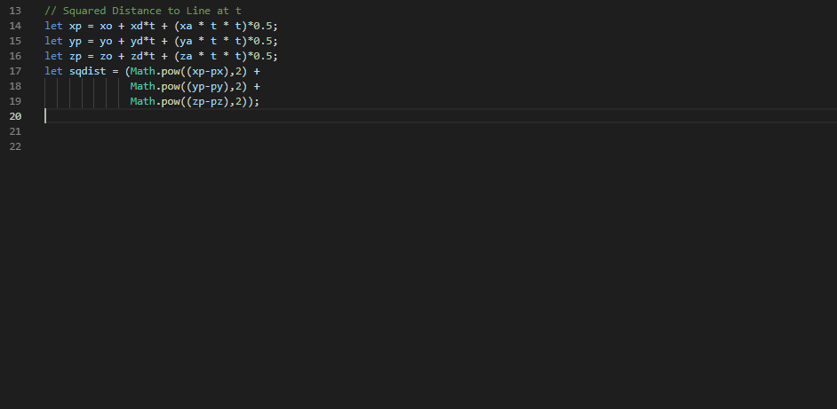
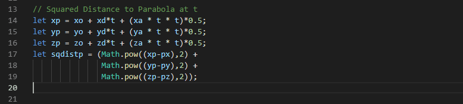

# [Symplex](https://marketplace.visualstudio.com/items?itemName=zalo.symplex)

A Symbolic CAS that operates directly on Javascript and Python code.

## Features

> Allows users to highlight blocks of math code and right-click to symbolically `integrate`, `diff`, `limit`, `solve`, `series`, and more!




> Enables beautiful code-to-LaTeX conversion via the `latex()` and unevaluated `Integral` and `Derivative` functions.




## Requirements

None!  SymPy 1.14 runs inside the extension via [Pyodide](https://pyodide.org) (CPython compiled to WebAssembly).

If you would rather use a locally installed Python (`pip install sympy`), set `"symplex.engine": "system"` — and point `"symplex.pythonPath"` at your interpreter if it isn't `python3`/`python` on your PATH.

## Settings

- `symplex.engine` — `embedded` (default, Pyodide) or `system` (local Python subprocess).
- `symplex.pythonPath` — interpreter used by the `system` engine.
- `symplex.timeoutSeconds` — how long a symbolic evaluation may run before it is cancelled (default 15).

## Known Issues

- Only variable assignment and basic arithmetic/trigonometric operations on real numbers are supported.  No for-Loops, control-statements, etc.  Unsupported syntax now fails with an explanatory error instead of producing corrupted expressions.

## Adding new languages

To add a new language:
- Implement the conversion of a block of that language's code to a SymPy string (`convertToSympy()`) in a new file under `src/converters/`.
- In `src/extension.ts`, add a case for your [language's identifier](https://code.visualstudio.com/docs/languages/identifiers) to `convertToSympy()`, and an entry to `CODE_STYLES`.
- In `python/symplex.py`, add an entry to `CODE_PRINTERS` (SymPy supports codegen in many languages already, so check to see if it's already there).
- Add it to the `package.json` menus/activation events as well, and test it by launching the extension with `F5`!

## Development

```bash
npm install
npm run compile     # or: npm run watch
npm test            # converter unit tests + an end-to-end embedded-SymPy test
npm run fetch-wheels  # cache the SymPy wheels locally for offline/packaged use
```

### Future Work

Add support for 
- Gradients
- Vectors/Matrices
- Algebraic "Functions"
- [Wolfram CAS Backend?](https://blog.wolfram.com/2019/05/16/announcing-the-wolfram-client-library-for-python/)

## Release Notes

### 0.0.4 - Add Snippets

Group all Symplex functionality underneath the `symplex.Evaluate` command.  Add snippets which document a few of the SymPy features that Symplex exposes.   Also make Python parsing slightly more robust. 


### 0.0.3 - Major Refactor

Allow writing of arbitrary SymPy operations, encapsulate adding support for new languages, and add LaTeX output!


### 0.0.2 - Python Support

Since `SymPy` operates natively in Python syntax, it was straight-forward to add basic Python support.


### 0.0.1 - Proof of Concept

Have proven that the typescript AST tree can be transformed into a `SymPy` compatible format, and that Python scripts can be invoked to perform arbitrary work for the editor at low-latencies.  The infrastructure is ready for massive expansion in capability, once the right UI affordances are found and the Javascript/Typescript parsing code is improved.
